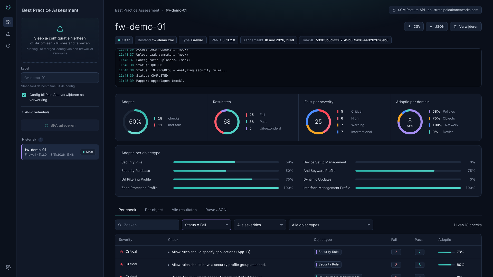

# bpa-tool

**Best Practice Assessment (BPA) voor Palo Alto Networks-firewalls en Panorama, via de nieuwe Posture API van Strata Cloud Manager.**

Sinds 30 april 2026 is de manuele On-Demand BPA-upload in Strata Cloud Manager en AIOps for NGFW uitgefaseerd.
Wie een BPA wil op basis van een configuratiebestand (bijvoorbeeld voor een klant, een air-gapped omgeving of een firewall zonder telemetry) moet nu de **Posture API** gebruiken.
Deze tool geeft die API een webinterface: config erin slepen, rapport eruit, overzichtelijk weergegeven.



<sub>Screenshots met fictieve voorbeelddata.</sub>

## Functies

- **Upload via drag & drop.** De tool leest hostname, PAN-OS-versie en type (firewall of Panorama) uit de XML.
- **Volledige API-flow:** token ophalen, upload-taak aanmaken, config uploaden, status pollen, rapport downloaden.
- **Overzicht in één oogopslag.** Je ziet de adoptiegraad, pass/fail/uitgezonderd, de fails per severity, de adoptie per domein (policies, objects, network, device) en de adoptie per objecttype.
- **Drie weergaves.** Per check (open een check om de falende objecten te zien), per object en alle resultaten. Je kunt filteren op status, severity en objecttype, en zoeken in de tekst.
- **Export** naar CSV (opent correct in Excel) en naar de originele JSON.
- **Historiek** van alle rapporten, bewaard in een Docker-volume.
- **Robuust tegen eigenaardigheden van de API.** Bij de limiet van 5 actieve jobs (HTTP 429) wacht de tool automatisch. Hij zoekt de downloadlink op meerdere plaatsen, pakt gzip-rapporten zelf uit en valt terug op een ruwe JSON-weergave als de structuur onbekend is.
- **Privacy:** de config wordt lokaal verwijderd zodra de upload gelukt is. Standaard vraagt de tool Palo Alto ook om de config na verwerking te wissen (`delete_after_processing`).
- **Mock-modus** om de tool zonder credentials uit te proberen.


## Hoe het werkt

```
Browser ──upload──▶ bpa-tool (FastAPI) ──▶ auth.apps.paloaltonetworks.com     OAuth2-token (client credentials, scope tsg_id:<TSG>)
                                       ──▶ POST /posture/checks/v1/reports/config-file-upload   → task_id + upload_url
                                       ──▶ PUT  <upload_url>                                     → config.xml
                                       ──▶ GET  /posture/checks/v1/reports/{task_id}/bpa-result  → pollen tot COMPLETED
                                       ──▶ GET  <report_url>                                     → JSON-rapport
```

De backend praat met de API. Je browser kan dat niet rechtstreeks (CORS), en zo komt je client secret nooit in de browser terecht.

## Vereisten

1. **Een Strata Cloud Manager-tenant** (TSG) met AIOps for NGFW. De gratis versie volstaat.
2. **Een service account** in *Common Services → Identity & Access* voor die TSG, met een rol die de Posture API mag gebruiken.
   Noteer de **Client ID**, de **Client Secret** (wordt maar één keer getoond) en de **TSG ID**.
   Een minimale rol is niet officieel gedocumenteerd. Krijg je `403 AUTHZ_DENIED`, verruim dan de rol, en controleer of die toegekend is op dezelfde TSG als `PAN_TSG_ID`.
3. **Docker** met Docker Compose, of Python 3.10+.

## Installatie

```bash
git clone https://github.com/seerdekens/bpa-tool.git
cd bpa-tool
cp .env.example .env
nano .env                      # PAN_CLIENT_ID, PAN_CLIENT_SECRET, PAN_TSG_ID
docker compose up -d --build
```

Open daarna `http://<host>:8000`.

**Bijwerken:**

```bash
./update.sh                    # git pull + container opnieuw bouwen; .env en rapporten blijven behouden
```

**Zonder Docker:**

```bash
pip install -r requirements.txt
uvicorn app:app --host 0.0.0.0 --port 8000
```

### Op Proxmox (LXC)

De tool draait prima in een kleine Debian-LXC: 1 vCPU, 1 GB RAM en 8 GB disk.
Zet bij de container onder *Options → Features* **nesting** en **keyctl** aan, installeer Docker (`curl -fsSL https://get.docker.com | sh`) en volg daarna de installatiestappen hierboven.

## De juiste config exporteren

| Situatie | Welk bestand |
|---|---|
| Firewall, lokaal beheerd | `running-config.xml` via *Device → Setup → Operations → Export named configuration snapshot* |
| Firewall, **beheerd door Panorama** | `.merged-running-config.xml`: de lokale config **plus** alles wat Panorama pusht |
| Panorama zelf | `running-config.xml` van Panorama (device groups en templates centraal beoordeeld) |

Een gewone export van een door Panorama beheerde firewall bevat de regels en objecten van Panorama **niet**. Haal de merged config op met:

```
scp export configuration from .merged-running-config.xml to gebruiker@<host>:/pad/fw-merged.xml
```

Of haal hem uit een tech support file (*Device → Support*), onder `opt/pancfg/mgmt/saved-configs/`.

## Configuratie

Alle instellingen gaan via omgevingsvariabelen, in `.env`. De velden in de webinterface overschrijven de credentials uit `.env` voor één aanvraag.

| Variabele | Standaard | Omschrijving |
|---|---|---|
| `PAN_CLIENT_ID` / `PAN_CLIENT_SECRET` / `PAN_TSG_ID` | – | Credentials van het service account |
| `PAN_API_BASE` | `https://api.strata.paloaltonetworks.com/posture/checks/v1` | Legacy: `https://api.sase.paloaltonetworks.com/posture/checks/v1` |
| `PAN_AUTH_URL` | `https://auth.apps.paloaltonetworks.com/oauth2/access_token` | Token-endpoint |
| `BPA_UPLOAD_GZIP` | `0` | `1` = config echt gzippen vóór de upload (zie [Problemen](#problemen-oplossen)) |
| `BPA_KEEP_CONFIG` | `0` | `1` = lokale kopie van de config bewaren na de upload |
| `BPA_POLL_INTERVAL` / `BPA_POLL_TIMEOUT` | `5` / `900` s | Pollen van de status |
| `BPA_QUEUE_TIMEOUT` | `600` s | Hoe lang wachten bij de limiet van 5 actieve jobs |
| `BPA_DATA_DIR` | `./data` (`/data` in Docker) | Rapporten en historiek |
| `BPA_MOCK` | `0` | `1` = geen echte API-calls, fictief voorbeeldrapport |

## Beveiliging

- **De tool heeft geen eigen login.** Draai hem enkel in een vertrouwd netwerk, of achter een reverse proxy met authenticatie (Nginx Proxy Manager, Traefik, Caddy…).
- **Configs zijn gevoelig:** ze bevatten wachtwoord-hashes, PSK's en de structuur van je netwerk.
  De tool verwijdert de lokale kopie na de upload. Rapporten blijven lokaal staan tot je ze verwijdert.
- **De client secret** blijft op de server. Hij wordt nooit naar de browser gestuurd.

## Problemen oplossen

| Melding | Oorzaak en oplossing |
|---|---|
| `401` bij het token | Client ID, Client Secret of TSG ID klopt niet. |
| `403 AUTHZ_DENIED` | Token is in orde, maar de rol van het service account mag de Posture API niet gebruiken, of staat op een andere TSG. Herstart de tool na een rolwijziging: tokens worden tot 15 minuten bewaard. |
| `429` | Je hebt 5 actieve BPA-jobs. De tool wacht automatisch tot er een plaats vrijkomt. |
| Verwerking eindigt in `FAILED` | Controleer of het bestand een volledige config is (root-element `<config>`). Probeer `BPA_UPLOAD_GZIP=1`. |
| Geen tabellen, alleen "Ruwe JSON" | Het rapport heeft een structuur die de tool niet herkent. Open een issue met een (geanonimiseerd) voorbeeld. |

## Projectstructuur

```
app.py               FastAPI-backend: API-flow, taken, opslag, mock-modus
static/index.html    Volledige frontend (HTML/CSS/JS, geen build-stap)
docker-compose.yml   Container + volume voor rapporten
update.sh            git pull + rebuild
docs/                Screenshots
```

## Licentie en disclaimer

Uitgebracht onder de [MIT-licentie](LICENSE).

Dit is een onafhankelijk project, niet verbonden aan of goedgekeurd door Palo Alto Networks.
PAN-OS, Panorama, Strata Cloud Manager en AIOps zijn handelsmerken van Palo Alto Networks.
Raadpleeg de [officiële API-documentatie](https://pan.dev/scm/api/config/posture-management/checks/) voor de actuele werking van de Posture API.
