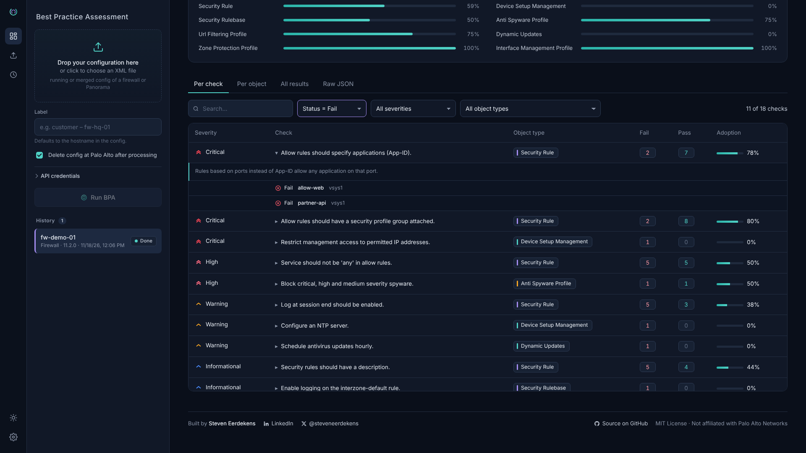
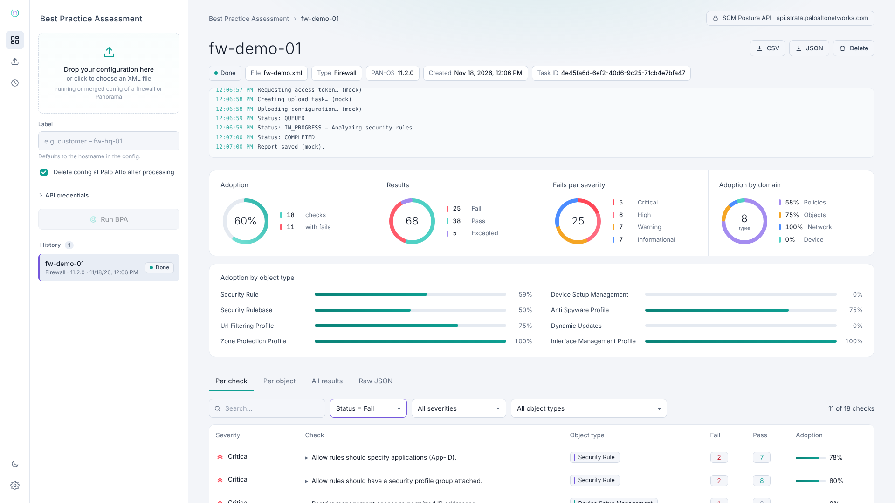

# bpa-tool

**Best Practice Assessment (BPA) for Palo Alto Networks firewalls and Panorama, using the new Strata Cloud Manager Posture API.**

As of April 30, 2026, the manual On-Demand BPA upload in Strata Cloud Manager and AIOps for NGFW has been retired.
If you want a BPA based on a configuration file (for a customer, an air-gapped environment, or a firewall without telemetry), you now need the **Posture API**.
This tool puts a web interface on top of it: drop in a config, get a clear report back.


<sub>Screenshots use fictional sample data.</sub>

## Features

- **Drag-and-drop upload.** The tool reads the hostname, PAN-OS version and type (firewall or Panorama) from the XML.
- **Complete API flow:** get a token, create an upload task, upload the config, poll the status, download the report.
- **Everything at a glance:** adoption rate, pass/fail/excepted, fails by severity, adoption by domain (policies, objects, network, device) and adoption by object type.
- **Three views.** By check (expand a check to see the failing objects), by object, and all results. Filter by status, severity and object type, or search the text.
- **Export** to CSV (opens correctly in Excel) and to the original JSON.
- **History** of all reports, kept in a Docker volume.
- **Resilient to API quirks.** When the limit of 5 active jobs is hit (HTTP 429), the tool waits automatically. It looks for the download link in several places, unpacks gzip reports itself, and falls back to a raw JSON view if the structure is unknown.
- **Privacy:** the local copy of the config is deleted as soon as the upload succeeds. By default the tool also asks Palo Alto to delete the config after processing (`delete_after_processing`).
- **Light and dark mode**, following your OS setting by default.
- **Mock mode** to try the tool without credentials.



Light and dark mode are both supported. The tool follows your OS setting on first visit and remembers your choice.



## How it works

```
Browser ──upload──▶ bpa-tool (FastAPI) ──▶ auth.apps.paloaltonetworks.com     OAuth2 token (client credentials, scope tsg_id:<TSG>)
                                       ──▶ POST /posture/checks/v1/reports/config-file-upload   → task_id + upload_url
                                       ──▶ PUT  <upload_url>                                     → config.xml
                                       ──▶ GET  /posture/checks/v1/reports/{task_id}/bpa-result  → poll until COMPLETED
                                       ──▶ GET  <report_url>                                     → JSON report
```

The backend talks to the API. Your browser can't do that directly (CORS), and this way your client secret never reaches the browser.

## Requirements

1. **A Strata Cloud Manager tenant** (TSG) with AIOps for NGFW. The free tier is enough.
2. **A service account** in *Common Services → Identity & Access* for that TSG, with a role that is allowed to use the Posture API.
   Write down the **Client ID**, the **Client Secret** (shown only once) and the **TSG ID**.
   A minimal role is not officially documented. If you get `403 AUTHZ_DENIED`, broaden the role and check that it is assigned on the same TSG as `PAN_TSG_ID`.
3. **Docker** with Docker Compose, or Python 3.10+.

## Installation

```bash
git clone https://github.com/seerdekens/bpa-tool.git
cd bpa-tool
cp .env.example .env
nano .env                      # PAN_CLIENT_ID, PAN_CLIENT_SECRET, PAN_TSG_ID
docker compose up -d --build
```

Then open `http://<host>:8000`.

**Updating:**

```bash
./update.sh                    # git pull + rebuild the container; .env and reports are kept
```

**Without Docker:**

```bash
pip install -r requirements.txt
uvicorn app:app --host 0.0.0.0 --port 8000
```

### On Proxmox (LXC)

The tool runs fine in a small Debian LXC: 1 vCPU, 1 GB RAM and 8 GB disk.
Under the container's *Options → Features*, enable **nesting** and **keyctl**. Install Docker (`curl -fsSL https://get.docker.com | sh`), then follow the installation steps above.

## Exporting the right config

| Situation | Which file |
|---|---|
| Locally managed firewall | `running-config.xml` via *Device → Setup → Operations → Export named configuration snapshot* |
| Firewall **managed by Panorama** | `.merged-running-config.xml`: the local config **plus** everything Panorama pushes |
| Panorama itself | Panorama's `running-config.xml` (device groups and templates assessed centrally) |

A regular export from a Panorama-managed firewall does **not** contain the rules and objects pushed by Panorama. Get the merged config with:

```
scp export configuration from .merged-running-config.xml to user@<host>:/path/fw-merged.xml
```

You can also take it from a tech support file (*Device → Support*), under `opt/pancfg/mgmt/saved-configs/`.

## Configuration

All settings are environment variables, set in `.env`. Credentials entered in the web interface override the ones in `.env` for that one request.

| Variable | Default | Description |
|---|---|---|
| `PAN_CLIENT_ID` / `PAN_CLIENT_SECRET` / `PAN_TSG_ID` | – | Service account credentials |
| `PAN_API_BASE` | `https://api.strata.paloaltonetworks.com/posture/checks/v1` | Legacy: `https://api.sase.paloaltonetworks.com/posture/checks/v1` |
| `PAN_AUTH_URL` | `https://auth.apps.paloaltonetworks.com/oauth2/access_token` | Token endpoint |
| `BPA_UPLOAD_GZIP` | `0` | `1` = actually gzip the config before upload (see [Troubleshooting](#troubleshooting)) |
| `BPA_KEEP_CONFIG` | `0` | `1` = keep the local copy of the config after upload |
| `BPA_POLL_INTERVAL` / `BPA_POLL_TIMEOUT` | `5` / `900` s | Status polling |
| `BPA_QUEUE_TIMEOUT` | `600` s | How long to wait when 5 jobs are already active |
| `BPA_DATA_DIR` | `./data` (`/data` in Docker) | Reports and history |
| `BPA_MOCK` | `0` | `1` = no real API calls, fictional sample report |

## Security

- **The tool has no login of its own.** Only run it on a trusted network, or behind a reverse proxy with authentication (Nginx Proxy Manager, Traefik, Caddy…).
- **Configs are sensitive:** they contain password hashes, PSKs and the layout of your network.
  The tool deletes the local copy after upload. Reports stay on disk until you delete them.
- **The client secret** stays on the server and is never sent to the browser.

## Troubleshooting

| Message | Cause and fix |
|---|---|
| `401` on the token | Client ID, Client Secret or TSG ID is wrong. |
| `403 AUTHZ_DENIED` | The token is fine, but the service account's role may not use the Posture API, or the role is on a different TSG. Restart the tool after changing a role: tokens are cached for up to 15 minutes. |
| `429` | You have 5 active BPA jobs. The tool waits until a slot frees up. |
| Processing ends in `FAILED` | Check that the file is a complete config (root element `<config>`). Try `BPA_UPLOAD_GZIP=1`. |
| No tables, only "Raw JSON" | The report has a structure the tool doesn't recognise. Please open an issue with an (anonymised) sample. |

## Project layout

```
app.py               FastAPI backend: API flow, tasks, storage, mock mode
static/index.html    Complete frontend (HTML/CSS/JS, no build step)
docker-compose.yml   Container + volume for reports
update.sh            git pull + rebuild
docs/                Screenshots
```

## Contributing

Issues and pull requests are welcome. See [CLAUDE.md](CLAUDE.md) for the architecture, the API quirks and how to test without credentials.
Never include real configs or reports in issues, tests or screenshots.

## Author

Built by **Steven Eerdekens** · [LinkedIn](https://be.linkedin.com/in/steveneerdekens) · [X](https://x.com/steveneerdekens)

## License and disclaimer

Released under the [MIT License](LICENSE).

This is an independent project. It is not affiliated with or endorsed by Palo Alto Networks.
PAN-OS, Panorama, Strata Cloud Manager and AIOps are trademarks of Palo Alto Networks.
See the [official API documentation](https://pan.dev/scm/api/config/posture-management/checks/) for the current behaviour of the Posture API.
